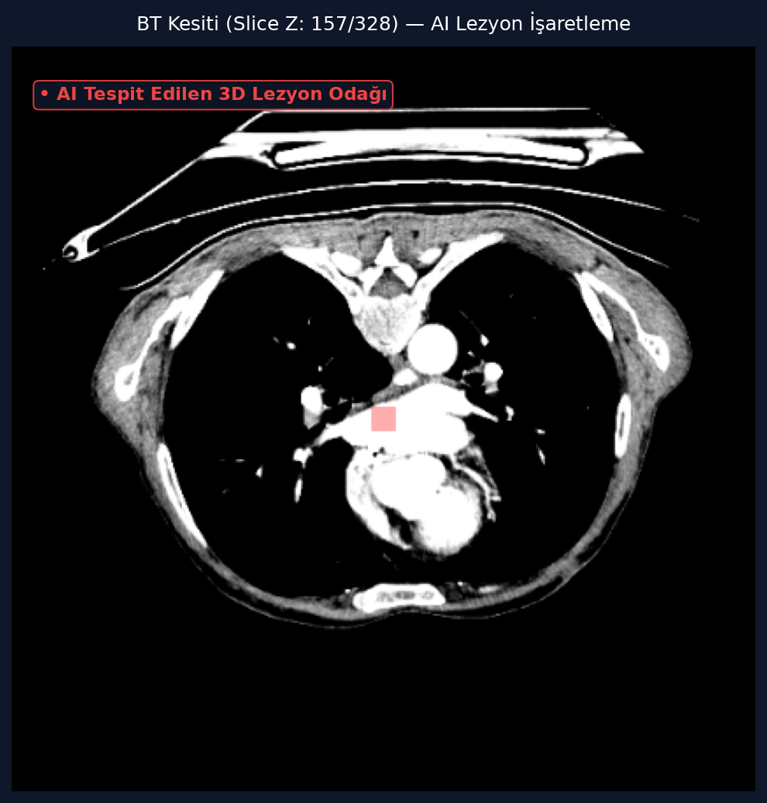
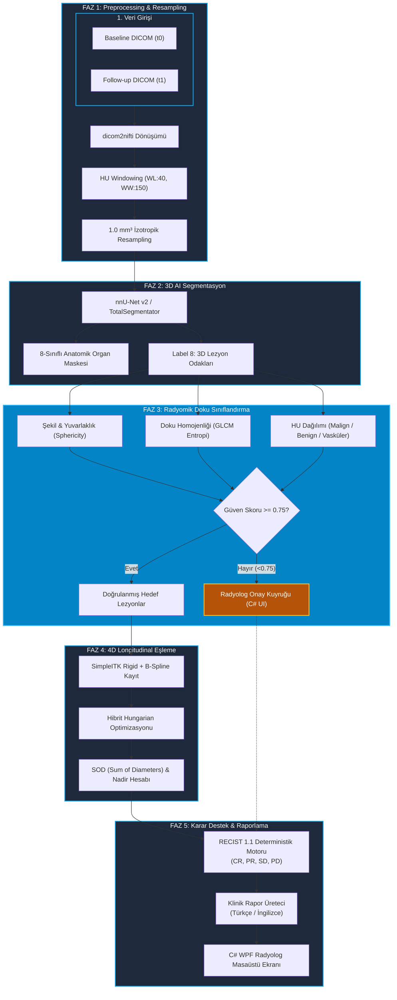

# HepaRECIST-AI: 4D Longitudinal Abdominal Tümör Takibi ve Otomatik RECIST 1.1 Tedavi Yanıtı Değerlendirme Platformu

<p align="center">
  
</p>

<p align="center">
  <strong>Medikal Bilgisayarlı Tomografi (BT) Taramalarında 3D Derin Öğrenme Segmentasyonu, Radyomik Doku Analizi, Deforme Edilebilir Kayıt (B-Spline Registration) ve RECIST 1.1 Standartlarında Otomatik Onkolojik Karar Destek Sistemi</strong>
</p>

<p align="center">
  <a href="https://www.python.org/"></a>
  <a href="https://dotnet.microsoft.com/"></a>
  <a href="https://fastapi.tiangolo.com/"></a>
  <a href="https://github.com/MIC-DKFZ/nnUNet"></a>
  <a href="https://simpleitk.org/"></a>
  <a href="https://recist.eortc.org/"></a>
</p>

---

## 📑 İçindekiler
- [Klinik Motivasyon ve Projenin Amacı](#-klinik-motivasyon-ve-projenin-amacı)
- [Öne Çıkan Temel Yetenekler](#-öne-çıkan-temel-yetenekler)
- [Sistem Mimarisi ve Uçtan Uca Boru Hattı](#-sistem-mimarisi-ve-uçtan-uca-boru-hattı)
- [Radyomik Güvenlik Filtresi ve Sınıflandırma](#-radyomik-güvenlik-filtresi-ve-sınıflandırma)
- [4D Longitudinal Lezyon Eşleme (Hungarian Match)](#-4d-longitudinal-lezyon-eşleme-hungarian-match)
- [RECIST 1.1 Deterministik Karar Matrisi](#-recist-11-deterministik-karar-matrisi)
- [Proje Modül Haritası](#-proje-modül-haritası)
- [Hızlı Başlangıç ve Kurulum Rehberi](#-hızlı-başlangıç-ve-kurulum-rehberi)
- [C# WPF Masaüstü Arayüzü Kullanımı](#-c-wpf-masaüstü-arayüzü-kullanımı)
- [İlgili Kılavuzlar ve Dökümanlar](#-ilgili-kılavuzlar-ve-dökümanlar)
- [Akademik Referanslar ve Yasal Uyarı](#-akademik-referanslar-ve-yasal-uyarı)

---

## 🏥 Klinik Motivasyon ve Projenin Amacı

Onkolojik tedavi süreçlerinde (kemoterapi, radyoterapi, hedefe yönelik tedaviler ve immünoterapi) hastanın tedaviye verdiği yanıtın objektif olarak ölçülmesi hayati öneme sahiptir. Dünya genelinde bu değerlendirme **RECIST 1.1 (Response Evaluation Criteria in Solid Tumors)** kılavuzuna göre yapılmaktadır.

### Karşılaşılan Klinik Zorluklar:
1. **Manuel Ölçüm Yükü & Zaman Kaybı:** Radyologların aksiyel kesitler üzerinde en uzun lezyon çaplarını manuel cetvelle işaretlemesi çok zaman alır.
2. **Gözlemciler Arası Değişkenlik (Inter-Observer Variability):** Farklı hekimler veya farklı zamanlarda yapılan ölçümlerde lezyon sınırlarının belirlenmesinde sapmalar meydana gelebilir.
3. **Nefes ve Organ Deformasyonları:** İki çekim arasındaki solunum fazı farklılıkları ve bağırsak hareketleri organların yer değiştirmesine ve aynı lezyonun kaybolmuş ya da yeni lezyonmuş gibi yanlış algılanmasına sebep olabilir.
4. **Komşu Patoloji Yanılgısı:** İyi huylu sıvı kistleri (0–20 HU) veya kontrastlı vasküler yapılar, tümör metastazı ile karıştırılabilmektedir.

### HepaRECIST-AI Çözümü:
**HepaRECIST-AI**, medikal BT taramalarından başlayarak ön işleme, 3D derin öğrenme segmentasyonu, radyomik doku ayırt etme, B-Spline elastik deformasyon düzeltmesi, Hibrit Hungarian eşleştirme ve Eisenhauer et al. (2009) standartlarında deterministik RECIST 1.1 yanıt analizi üreten ve bunu yapılandırılmış klinik raporlara döken **uçtan uca otonom ve hekim kontrollü (Human-in-the-Loop)** bir platformdur.

---

## ⭐ Öne Çıkan Temel Yetenekler

| Yetenek | Açıklama |
|---|---|
| 🧠 **8-Sınıflı 3D Segmentasyon** | Karaciğer, Dalak, Böbrekler, Pankreas, Safra Kesesi, Mide, Aorta ve Tümör/Metastaz Lezyonlarının (Label 8) 3D olarak ayrıştırılması. |
| 🔬 **Radyomik Güvenlik Filtresi** | 3D Küresellik ($\Psi$), Doku Entropisi (GLCM) ve HU yoğunluk dağılımı ile Malign, Benign (Kist) ve Vasküler doku ayrımı. |
| 🛡️ **Radyolog Onay Kuyruğu** | Güven skoru $<0.75$ olan sınırda veya belirsiz lezyonları hekim incelemesine yönlendiren Human-in-the-Loop koruma mekanizması. |
| 🎯 **4D B-Spline Deformable Match** | $t_0$ (Baseline) ve $t_1$ (Follow-up) arasındaki solunum deformasyonlarını gideren B-Spline Registration + Hungarian optimizasyon algoritması. |
| ⚖️ **Kuralcı RECIST 1.1 Karar Motoru** | Eisenhauer 2009 kurallarına tam uyumlu; Nadir takibi yapan, CR / PR / SD / PD kararlarını deterministik üreten motor. |
| 📄 **Çift Modlu Klinik Raporlama** | Çevrimdışı deterministik klinik şablon modu veya sıfır halüsinasyon kısıtlı (`temperature=0.0`) Gemini LLM açıklama modu. |
| 💻 **C# WPF Radyolog İş İstasyonu** | .NET 9 tabanlı, `fo-dicom` ile hasta künyesi okuyan, dinamik renkli karar rozetleri ve aksiyel önizleme sunan masaüstü kokpiti. |

---

## 🏗️ Sistem Mimarisi ve Uçtan Uca Boru Hattı

HepaRECIST-AI, görüntü alımından klinik karar raporuna kadar **5 temel fazdan** oluşan katmanlı bir mimariye sahiptir:



---

## 🔬 Radyomik Güvenlik Filtresi ve Sınıflandırma

Yapay zeka modellerinin kist veya damarları tümör metastazı zannetmesini önlemek amacıyla her lezyon adayı için 3 temel radyomik metrik hesaplanır:

1. **3D Küresellik (Sphericity $\Psi$):**
   $$\Psi = \frac{\pi^{\frac{1}{3}} (6 V)^{\frac{2}{3}}}{A}$$
   *(Burada $V$ lezyon hacmi, $A$ ise 3D yüzey alanıdır. Kistler yüksek küreselliğe sahipken malign lezyonlar düzensiz ve infiltratiftir).*
2. **HU Dağılım Analizi:**
   - **Benign Basit Kist:** $0 - 20\text{ HU}$ arası, homojen iç yapı.
   - **Malign Tümör / Metastaz:** $25 - 85\text{ HU}$ arası, kontrast tutulumu ve heterojen nekroz alanları.
   - **Vasküler Yapı / Kalsifikasyon:** $> 120\text{ HU}$ veya negatif değerler (lipom).
3. **Doku Entropisi (GLCM Haritası):** Nekrotik ve tümöral hücresel heterojenliğin tespiti.

> ⚠️ **Hekim Güvenlik Kilidi:** Sistem güven skoru $\%75$'in altındaki tüm lezyonları otomatik olarak C# WPF arayüzündeki **Radyolog İnceleme Paneline** aktarır. Hekim onayı olmadan bu lezyonlar hedef değerlendirmeye dahil edilmez.

---

## 🎯 4D Longitudinal Lezyon Eşleme (Hungarian Match)

Zaman serisi çekimlerde ($t_0 \rightarrow t_1$) lezyon takibinin doğruluğu iki aşamalı bir algoritma ile garanti altına alınır:

1. **SimpleITK Deformable Registration:** Hasta organlarının solunum ve pozisyon kaynaklı kaymalarını düzeltmek için $t_0$ görüntüsü, $t_1$ görüntüsüne Rigid (Euler3D) ve ardından B-Spline elastik deformasyon alanı ile hizalanır.
2. **Hibrit Hungarian Maliyet Matrisi:** $t_0$ ve $t_1$ lezyonları arasındaki mesafe ve geometri şu maliyet formülü ile eşleştirilir:
   $$\text{Maliyet} = 0.50 \cdot D_{\text{Öklid}} + 0.30 \cdot \left|1 - \frac{V_{t1}}{V_{t0}}\right| + 0.20 \cdot \left|1 - \frac{d_{t1}}{d_{t0}}\right|$$
   - **Eşleşen Lezyonlar:** Çap değişimi ölçülerek SOD (Sum of Diameters) hesabına eklenir.
   - **Eşleşmeyen $t_1$ Adayları:** Potansiyel **Yeni Lezyon** adayı olarak işaretlenir.
   - **Eşleşmeyen $t_0$ Adayları:** **Tamamen Kaybolan (Regressed)** lezyon kabul edilir.

---

## ⚖️ RECIST 1.1 Deterministik Karar Matrisi

Eisenhauer et al. (2009) kuralları doğrultusunda sistem kararları asla yapay zekanın sezgisel tahminine bırakılmaz; deterministik matematiksel kurallarla verilir:

| Yanıt Kategorisi | Tanım | Matematiksel Kriter (RECIST 1.1) | Arayüz Rozeti |
|---|---|---|---|
| **CR** *(Complete Response)* | Tam Yanıt | Tüm hedef lezyonlar tamamen kaybolmuş ($SOD_{t1} = 0\text{ mm}$). | 🟢 **Yeşil** |
| **PR** *(Partial Response)* | Kısmi Yanıt | Bazal $SOD_{bl}$ değerine göre toplam çapta en az **%30 azalma**. | 🔵 **Mavi** |
| **PD** *(Progressive Disease)* | İlerleyici Hastalık | Tedavi süresince görülen en küçük $SOD_{\text{nadir}}$ değerine göre **$\ge \%20$ artış VE mutlak $\ge 5\text{ mm}$ büyüme** VEYA **Doğrulanmış Yeni Lezyon**. | 🔴 **Kırmızı** |
| **SD** *(Stable Disease)* | Stabil Hastalık | Ne PR için yeterli küçülme ne de PD için yeterli büyüme var. | 🟡 **Sarı** |
| **NE** *(Not Evaluable)* | Değerlendirilemez | Bazal çekimde ölçülebilir hedef lezyon bulunamadı. | ⚪ **Gri** |

---

## 📂 Proje Modül Haritası

```
c:\Projects\YazOkuluDetect\
├── YazOkuluDetectUI\           # C# WPF (.NET 9) Masaüstü Radyolog Arayüzü
│   ├── MainWindow.xaml         # Koyu modlu modern hekim kokpiti tasarımı
│   ├── MainWindow.xaml.cs      # fo-dicom entegrasyonu, REST istemcisi ve durum kontrolü
│   └── YazOkuluDetectUI.csproj # WPF proje ve bağımlılık tanımları
├── preprocess.py               # DICOM -> NIfTI, HU Windowing (-35/+115), 1mm³ izotropik resampling
├── inference.py                # 3D nnU-Net v2 çıkarım motoru & Güvenli Mock modu
├── radiomics_module.py         # 3D Küresellik, GLCM Entropi ve HU doku sınıflandırma motoru
├── matching_engine.py          # SimpleITK B-Spline Deformable Registration & Hungarian Lezyon Eşleme
├── recist_engine.py            # Eisenhauer et al. (2009) deterministik RECIST 1.1 kural motoru
├── pipeline.py                 # 6 fazı uçtan uca orkestre eden ana boru hattı (run_full_pipeline)
├── report_generator.py         # Çift modlu klinik rapor üreteci (Deterministik Şablon & Gemini LLM)
├── visualizer.py               # Aksiyel 2D kesit, lezyon renklendirme ve 4D karşılaştırma görselleştiricisi
├── prepare_training_data.py    # TotalSegmentator (7 organ) + Manuel Lezyon (Label 8) entegrasyonu
├── prepare_nnunet_data.py      # Klasördeki NIfTI'leri nnU-Net v2 Dataset001 formatına dönüştürücü
├── main.py                     # FastAPI REST API sunucusu (Uvicorn tabanlı uç noktalar)
├── requirements.txt            # Python kütüphane ve bağımlılık listesi
├── implementation_plan.md      # 55 Hasta / 106 CT serisi faz planı ve veri şartnamesi
├── HOW_TO_RUN.md               # Adım adım ayrıntılı kurulum ve çalıştırma rehberi
└── system_report_and_guide.md  # 5-Fazlı mimari şartname ve akademik sistem raporu
```

---

## 🚀 Hızlı Başlangıç ve Kurulum Rehberi

Platformu yerel ortamınızda çalıştırmak için aşağıdaki adımları sırasıyla uygulayınız.

### 📋 Ön Gereksinimler
- **İşletim Sistemi:** Windows 10 / 11 (64-bit)
- **Python:** 3.10 veya üzeri
- **.NET SDK:** .NET 9.0 SDK
- *(İsteğe Bağlı GPU):* CUDA 11.8+ destekli NVIDIA Ekran Kartı (nnU-Net gerçek çıkarımı için)

---

### Adım 1: Python Backend Sunucusunu Başlatma

1. Bir terminal (PowerShell) açın ve proje dizinine gidin:
   ```powershell
   cd c:\Projects\YazOkuluDetect
   ```

2. Python sanal ortamını oluşturun ve etkinleştirin:
   ```powershell
   python -m venv .venv
   .\.venv\Scripts\Activate.ps1
   ```

3. Gerekli kütüphaneleri yükleyin:
   ```powershell
   pip install -r requirements.txt
   ```

4. FastAPI sunucusunu ayağa kaldırın:
   ```powershell
   uvicorn main:app --reload --host 127.0.0.1 --port 8000
   ```

5. **Doğrulama:** Tarayıcınızdan `http://127.0.0.1:8000/docs` adresini açarak etkileşimli Swagger API dokümantasyonunu inceleyebilirsiniz.

---

### Adım 2: C# WPF Masaüstü Uygulamasını Başlatma

Python sunucusu çalışırken yeni bir terminal açarak masaüstü arayüzünü başlatın:

```powershell
cd c:\Projects\YazOkuluDetect
dotnet run --project YazOkuluDetectUI\YazOkuluDetectUI.csproj
```
*(Alternatif olarak `YazOkuluDetectUI\YazOkuluDetectUI.csproj` dosyasını Visual Studio 2022 ile açıp `F5` tuşuna basabilirsiniz).*

---

## 🖥️ C# WPF Masaüstü Arayüzü Kullanımı

1. **API Durumu:** Uygulama açıldığında sol üst köşedeki **"Python API: Bağlı"** yeşil göstergesini kontrol edin.
2. **DICOM Klasörü Seçimi:** **"DICOM Klasörü Seç"** butonuna basarak hasta tetkik dizinini gösterin. `fo-dicom` motoru Hasta ID, Ad ve Tarih bilgisini otomatik yükler.
3. **Ön İşleme (Preprocessing):** **"1. DICOM Ön İşleme"** ile veriyi $1\text{ mm}^3$ izotropik NIfTI formatına çevirin.
4. **Segmentasyon:** **"2. AI Segmentasyon"** ile 3D lezyon adaylarını çıkarın ve aksiyel kesit üzerinde görselleştirin.
5. **RECIST 1.1 Kararı:** **"3. RECIST 1.1 Kararı Al"** butonuna basarak deterministik yanıt rozetini (CR, PR, SD, PD) ve klinik onkoloji raporunu oluşturun.

---

## 📚 İlgili Kılavuzlar ve Dökümanlar

- 📖 **[HOW_TO_RUN.md](HOW_TO_RUN.md):** Hata çözümleri, port çakışmaları ve adım adım kapsamlı test senaryoları.
- 📐 **[system_report_and_guide.md](system_report_and_guide.md):** 5-Fazlı tam katmanlı mimarinin detaylı teknik raporu ve RunPod / Colab model eğitimi rehberi.
- 📋 **[implementation_plan.md](implementation_plan.md):** Veri seti dağılımı, PACS DICOM entegrasyonu ve geliştirme aşamaları planı.

---

## 📖 Akademik Referanslar ve Yasal Uyarı

1. **RECIST 1.1 Kılavuzu:** Eisenhauer, E. A., et al. (2009). *New response evaluation criteria in solid tumours: revised RECIST guideline (version 1.1)*. European Journal of Cancer, 45(2), 228-247.
2. **nnU-Net v2:** Isensee, F., Jaeger, P. F., Kohl, S. A., Petersen, J., & Maier-Hein, K. H. (2021). *nnU-Net: a self-configuring method for deep learning-based biomedical image segmentation*. Nature Methods, 18(2), 203-211.
3. **TotalSegmentator:** Wasserthal, J., et al. (2023). *TotalSegmentator: Robust Segmentation of 104 Anatomical Structures in CT Images*. Radiology: Artificial Intelligence, 5(5), e230024.

> ⚖️ **Klinik ve Yasal Uyarı (Investigational Use Only):**  
> Bu yazılım bir araştırma ve akademik karar destek prototipidir. Nihai medikal kararlar ve hasta tedavi protokolleri uzman hekim ve radyolog sorumluluğundadır. Tek başına tanı ve tedavi amacıyla doğrudan kullanılamaz.

---

<p align="center">
  <sub>Geliştirici Ekip &bull; HepaRECIST-AI Projesi &bull; 2026</sub>
</p>
